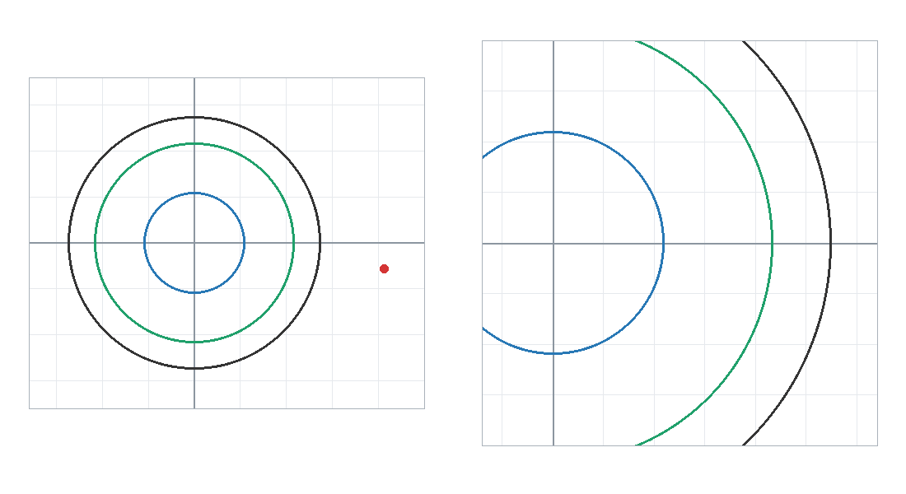
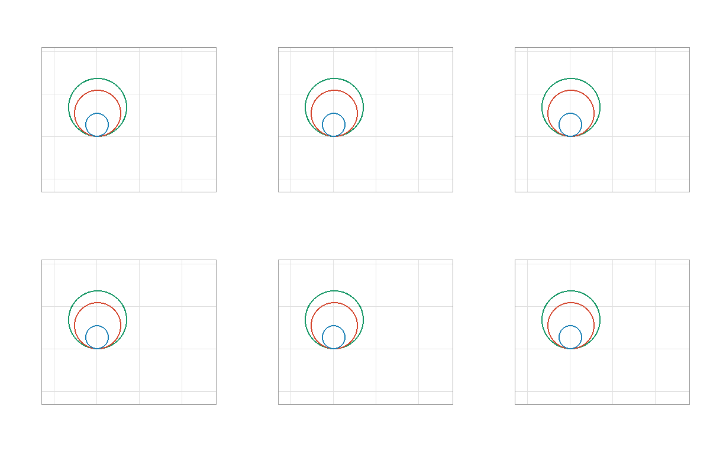
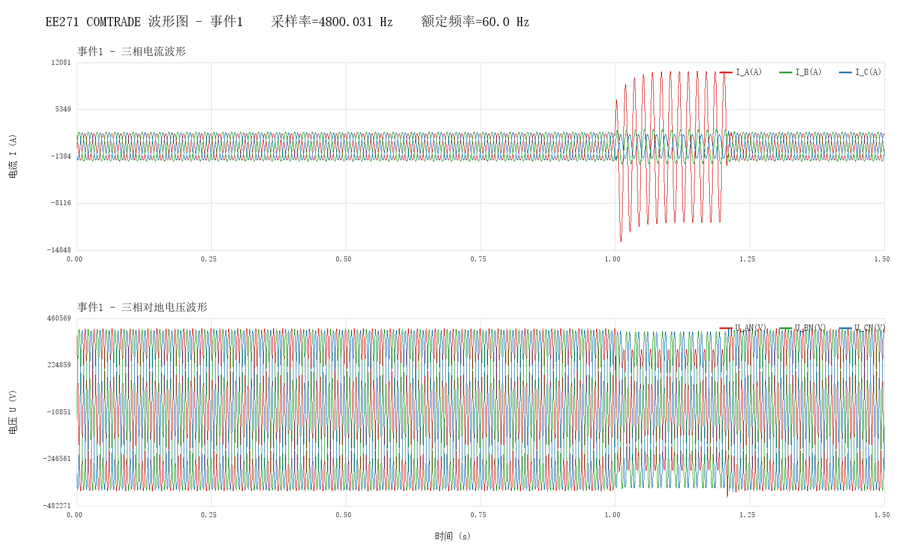
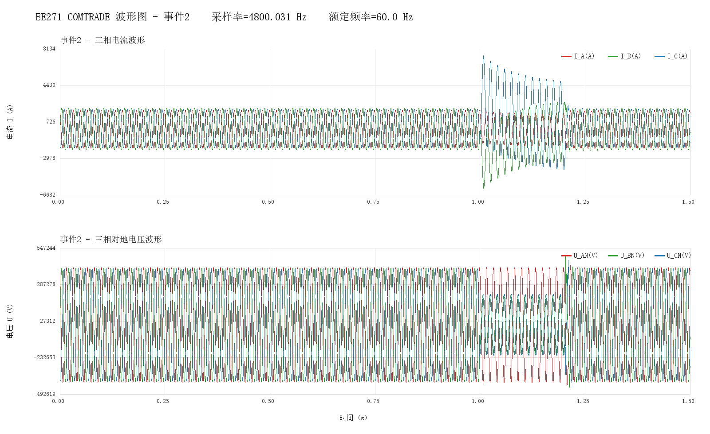
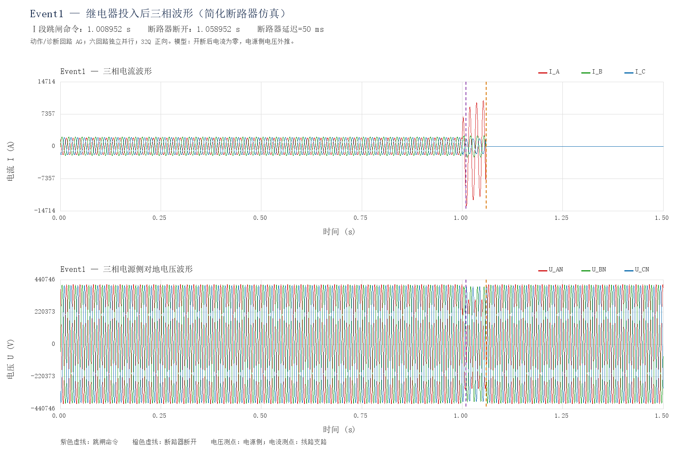
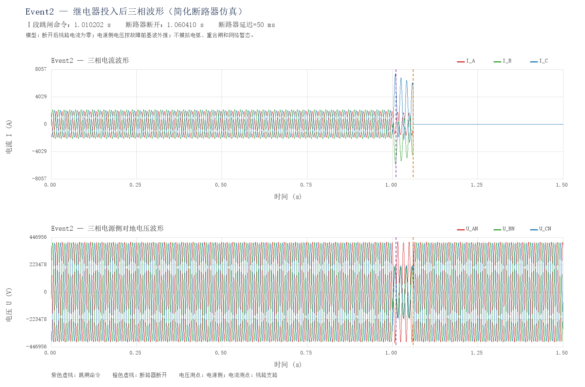

# 三段数字式距离保护继电器

EE271 课程项目的 Python 实现。读取两组 COMTRADE 录波，用一周波 DFT 估计基波相量，计算接地或相间测量阻抗，通过三段普通阻抗圆、延时和跳闸锁存逻辑完成保护回放，并加入理想断路器生成开断演示。

这是教学用离线录波回放，并非工程保护装置，也不是完整电网电磁暂态仿真。默认配置下，两组事件均由 I 段发出跳闸命令。

## 作者与使用声明 Author and Use Notice

本项目代码由本人（本仓库作者）编写和维护，第三方依赖及材料的权利归各自权利人所有。代码和结果按现状提供，仅供学习、交流与研究，不保证适用于实际电力系统或任何特定用途。使用者应自行验证算法、整定参数和结果；任何实际应用均由使用者自行评估风险并承担相应责任。在适用法律允许的范围内，作者不对使用或无法使用本项目导致的损失承担责任。本声明不排除适用法律规定不得排除或限制的责任。

The project code was written and is maintained by me, the author of this repository. Rights in third-party dependencies and materials remain with their respective rights holders. The code and results are provided as is for learning, discussion, and research, without any guarantee of suitability for an actual power system or any particular purpose. Users must independently validate the algorithms, settings, and results, assess the risks of any practical application, and assume the associated responsibility. To the extent permitted by applicable law, the author is not liable for losses arising from the use of, or inability to use, this project. This notice does not exclude or limit liability that cannot lawfully be excluded or limited.

原始 PDF 和录波数据获取自互联网，不是本人创作，不属于本人的原创成果；其版权及其他权利归原作者或其他权利人所有。网络公开可下载不代表可以自由使用或再发布。请参阅 [完整中英文声明](NOTICE.md) 和 [第三方材料说明](inputs/README.md)。

The original PDF and waveform data were obtained from the Internet. They were not created by me and are not claimed as my original work. Copyright and other rights remain with their original authors or other rights holders. Public availability online does not imply permission for unrestricted use or redistribution. See the [full bilingual notice](NOTICE.md) and [third-party materials notice](inputs/README.md).

## 动态阻抗轨迹

每个 GIF 只包含坐标轴、网格、三个动作圆、轨迹和移动测量点，不含标题、数字、图例或说明文字。

左图为全景，右图为局部放大；两个视图都保持 R、X 两轴等比例。横向为电阻 R，纵向为电抗 X，物理单位为 Ω。蓝、绿、灰圆分别对应 I、II、III 段，红线为累计轨迹，红点为当前测量值。三个圆固定不动，移动的是测量点。

### Event1 AG 接地回路



### Event2 BC 相间回路



动画默认展示录波时间 0.98～1.05 s，早于断路器开断。动画为放慢播放，不代表真实故障持续数秒；整个进入过程仍由实际采样值计算。

## 目录

```text
.
├── data.py                         # 原始数据转 CSV 和静态波形
├── distance_relay.py               # 继电器核心算法与终端输出
├── simulate_with_relay.py          # 断路器联动、Excel、波形与 GIF
├── README.md
├── NOTICE.md                       # 中英文作者 风险及第三方材料声明
├── requirements.txt
├── .gitignore
├── inputs/
│   ├── README.md                   # 第三方材料总说明
│   ├── assignment/
│   │   └── EE271_TermProject_Fall2023G.pdf
│   └── comtrade/
│       ├── EE271_DistanceProtection_Event1.cfg
│       ├── EE271_DistanceProtection_Event1.dat
│       ├── EE271_DistanceProtection_Event2.cfg
│       └── EE271_DistanceProtection_Event2.dat
├── assets/                         # README 使用的波形 PNG 与轨迹 GIF
└── outputs/                        # 运行生成，已列入 .gitignore
    ├── raw/
    ├── relay/
    └── simulation/
```

仓库只使用上面三个 Python 程序，不依赖 MATLAB、Node.js、办公软件或某台电脑的专有运行时。输入和默认输出路径均相对于程序目录，不要求从特定工作目录运行。

上面的 PDF、CFG、DAT 文件名表示程序期望的材料位置。当前本地整理文件夹中保留了这些第三方原始材料；公开发布前须确认再发布权限，未确认时应从公开版本中移除，并由使用者在取得适当许可后自行放入。`assets/` 中保留了根据样例数据生成的演示图。

The PDF, CFG, and DAT names above indicate the expected input locations. These third-party original materials are retained in the current locally prepared folder. Confirm redistribution permissions before publishing them; otherwise remove them from the public release and have users supply them after obtaining appropriate permissions. The `assets/` directory retains demonstration figures generated from the sample data.

## 安装与运行

使用 Python 3.10 或更高版本。在项目目录中执行：

```bash
python -m venv .venv
```

Windows PowerShell 激活环境：

```powershell
.\.venv\Scripts\Activate.ps1
python -m pip install -r requirements.txt
```

macOS / Linux：

```bash
source .venv/bin/activate
python -m pip install -r requirements.txt
```

也可以不激活环境，直接调用 `.venv` 中的 Python。Linux/macOS 上若命令名为 `python3`，相应替换即可。

### 1 生成原始数据表格和波形

```bash
python data.py
```

输出 `outputs/raw/` 下两个事件的 CSV、PNG，以及 `processing_summary.csv`。CSV 使用 UTF-8 BOM，便于 Excel 读取中文；它不是 `.xlsx` 工作簿。

### 2 查看继电器判断

分别在两个终端运行：

```bash
python distance_relay.py --event 1
python distance_relay.py --event 2
```

Windows 上直接运行 `python distance_relay.py` 会分别打开两个事件窗口。其他系统可用 `--single-window` 在同一终端依次处理。终端按约 0.02 s 的录波时间间隔追加一行，保留时间、回路 U/I/Z、动作区、II/III 段计时和跳闸结果；算法仍逐采样计算，不受显示间隔影响。

只计算和保存结果，不实时显示或打开窗口：

```bash
python distance_relay.py --event all --no-live
```

结果为 `outputs/relay/relay_Event1_results.csv`、`relay_Event2_results.csv`。可用 `--speed 0.1` 放慢回放，`--repeat` 循环回放，Ctrl+C 停止。

### 3 生成保护投入后的结果

```bash
python simulate_with_relay.py
```

每个事件在 `outputs/simulation/` 生成：

- `EventN_with_relay_data.xlsx`：包含“继电器投入后波形”和“原始录波”两个工作表。
- `EventN_with_relay_waveforms.png`：三相电流、电源侧对地电压，以及跳闸和开断时刻。
- `EventN_RX_trajectory.gif`：无文字的动态阻抗圆与轨迹。
- `summary.json`：本次各事件的测量回路、定值半径、跳闸和开断时刻。

只生成 GIF，或调整仿真参数：

```bash
python simulate_with_relay.py --gif-only
python simulate_with_relay.py --event 1 --gif-only --gif-start 0.98 --gif-end 1.05 --gif-frames 120
python simulate_with_relay.py --breaker-delay 0.08
```

GIF 只连接电流足够大时有效的测量点。建议保持默认故障初期时间窗；开断后近零电流下阻抗无定义，不应作为正常轨迹继续连接。改变参数后，以新生成文件为准，`assets/` 中的预览不会自动替换。

### 中文字体

波形 PNG 需要系统安装中文字体。程序查找 Windows 宋体/微软雅黑/黑体、macOS 苹方、Linux Noto CJK 或文泉驿。未找到时，请安装中文字体并指定文件：

```powershell
$env:RELAY_FONT_PATH = 'C:\Windows\Fonts\simsun.ttc'
```

```bash
export RELAY_FONT_PATH=/path/to/your/chinese-font.ttc
```

仓库不捆绑系统字体。`--gif-only` 不需要字体。

## 算法与整定

系统额定线电压 500 kV，工频 60 Hz，录波采样率约 4800.031 Hz；每组 7200 点，约 1.5 s。滑动窗约为一周波 80 点，计算基波 RMS 相量，而不是直接用瞬时电压除以瞬时电流。

被保护线路：

$$Z_1=Z_2=2.1272+j68.7150\ \Omega,\qquad Z_0=60.8130+j222.4585\ \Omega$$

相邻线路：

$$Z_{1,\mathrm{adj}}=3.4728+j73.6720\ \Omega$$

### 接地回路与相间回路

Event1 默认使用 AG 回路，零序补偿将接地测量量修正到与正序阻抗整定对应的形式：

$$I_0=\frac{I_A+I_B+I_C}{3},\qquad K_0=\frac{Z_0-Z_1}{3Z_1}=0.753893-j0.261344$$

$$Z_{AG}=\frac{U_A}{I_A+K_0(I_A+I_B+I_C)}$$

此处的补偿量是三相电流之和，即 $3I_0$，不要误把它换成 $I_0$ 而仍使用相同的 $K_0$。

Event2 默认使用 BC 回路，不作接地零序补偿：

$$Z_{BC}=\frac{U_B-U_C}{I_B-I_C}$$

AG、BG、CG、AB、BC、CA 回路计算函数均保留；核心程序可用 `--loop` 手动指定，但本项目默认测试的是 AG 和 BC。按事件名称选回路不等于自动故障分类。

### 三段普通阻抗圆

$$|Z_{\mathrm{meas}}|\leq |Z_{\mathrm{set}}^q|,\qquad q=\mathrm{I},\mathrm{II},\mathrm{III}$$

| 段别 | 整定值 Ω | 圆半径 Ω | 附加延时 s |
| --- | --- | ---: | ---: |
| I | 1.701760 + j54.972000 | 54.998 | 0 |
| II | 4.169624 + j108.504710 | 108.585 | 0.30 |
| III | 4.253426 + j137.398529 | 137.464 | 1.00 |

I 段取本线路正序阻抗的 80%；II 段采用 $0.85[Z_1+1.00\times0.80Z_{1,\mathrm{adj}}]$；III 段按最低负荷阻抗躲避条件确定半径，假设最大负荷电流 1.50 kA，可靠系数 1.20、自启动系数 1.00、返回系数 1.05。III 段所存复数的相角取线路角，但普通圆判断只使用幅值。

三个元件并行运行。II、III 段在圆内连续计时，离区立即复归；首次跳闸时刻和段别锁存。回路电流不足 20 A 时不计算阻抗，三个距离元件不启动。零附加延时不代表故障发生瞬间即可识别，仍存在滑动窗测量时间。

整定参数集中在 `distance_relay.py` 顶部常量和 `build_settings()` 中；一次运行内保持固定。

## 两组算例结果

| 事件 | 默认回路与故障判断 | 跳闸段 | 跳闸命令 s | 理想断路器断开 s |
| --- | --- | --- | ---: | ---: |
| Event1 | AG，A 相接地 | I | 1.008535 | 1.058535 |
| Event2 | BC，BC 相间短路 | I | 1.010202 | 1.060410 |

两组原始录波均约在 1.000 s 出现故障变化。故障后约 1.10 s 的原始录波中，AG 阻抗约为 $0.906+j15.781\ \Omega$，BC 阻抗约为 $8.740-j14.092\ \Omega$。这里引用的是原始录波测量值，不是已开断仿真在 1.10 s 的阻抗。

断路器目标开断时刻为“命令时刻 + 延迟”，实际取不早于目标时刻的第一个采样点。Event2 约 0.208 ms 的额外差异来自离散采样。

原始波形：




保护投入后的演示波形：




## 已知限制

- 普通阻抗圆不具备方向选择性。Event2 电抗为负不被改为正值；在圆内动作并不能证明它是本线路正方向内部故障。
- 事件回路按文件名预先选择；没有实现未知故障类型自动识别。
- 两组事件均由 I 段动作，不能用它们证明 II、III 段延时动作、区外不误动和所有故障类型覆盖均已通过验证。
- III 段近后备灵敏度约 1.9995，但在分支系数 1.00 的假设下远后备灵敏度约 0.9647，低于 1.2；当前整定不是已完成全部工程配合的定值。
- 最大负荷 1.50 kA 是参考故障前录波采用的演示假设，不是已确认的系统最大运行负荷；II、III 段时限也未完成完整网络配合验证。
- 断开后三相电流直接置零、电源侧电压按故障前基波外推。不模拟电弧、过零灭弧、重合闸、开断过电压或远端网络响应。
- 当前 COMTRADE 读取针对本题的单采样率 BINARY 记录和六模拟量通道排列，不是通用的完整 COMTRADE 标准实现。
- 原录波本身存在故障结束过程，不应将它描述成“完全没有其他保护”的真实电网对照。

## 许可证与第三方材料 License and Third-Party Materials

作者与免责声明不等同于开源许可证。目前尚未指定代码许可证；正式开源发布前，应另行选择并添加 `LICENSE`，具体使用、修改和再分发权限以该许可证为准。参见 [GitHub 关于仓库许可证的说明](https://docs.github.com/en/repositories/managing-your-repositorys-settings-and-features/customizing-your-repository/licensing-a-repository)。

An authorship notice and disclaimer are not an open-source license. No code license has been selected yet. Before an open-source release, a separate `LICENSE` should be selected and added; permissions to use, modify, and redistribute the code will be governed by that license. See [GitHub's guidance on repository licensing](https://docs.github.com/en/repositories/managing-your-repositorys-settings-and-features/customizing-your-repository/licensing-a-repository).

任何后续代码许可证均不自动覆盖原始题目 PDF、录波数据、系统字体或第三方依赖。这些材料应遵守各自的权利声明和许可条件。若权利人认为本项目对相关材料的引用或使用存在问题，请通过仓库 Issue 联系维护者处理。

Any future code license does not automatically cover the original assignment PDF, waveform data, system fonts, or third-party dependencies. Their respective rights notices and license terms apply. Rights holders who have concerns about references to or use of their materials may contact the maintainer through a repository issue.

本项目未经工程认证，不应未经独立审查、充分试验和必要批准直接用于实际电网跳闸控制。

This project has not been engineering-certified and must not be deployed directly for actual power-system tripping without independent review, sufficient testing, and any necessary approvals.
